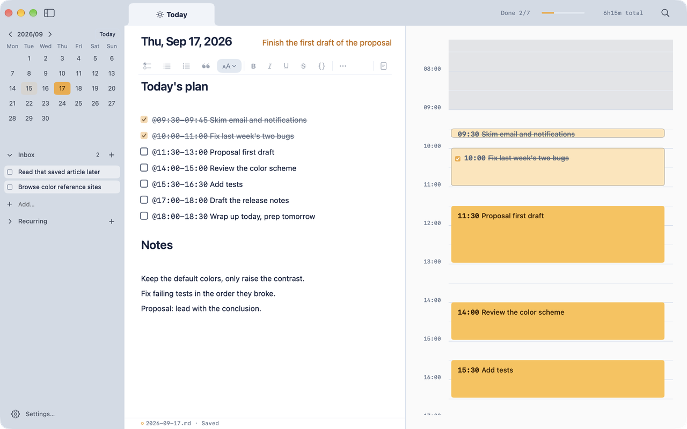

# FirnPlanner

A daily planner for macOS. Tasks you write in Markdown are placed on a one-day timeline as you type.

## Features

- **Your text becomes the schedule**: write a checkbox line like `- [ ] Draft the report` and it is placed on the timeline right away. There is no separate screen for entering times or durations
- **Timeline**: adjust the plan by dragging a task to move it or pulling its edge to change its length. Each time slot holds one task, and overlaps are packed again automatically
- **Pinned times**: put a time at the start of a line, as in `- [ ] @09:30 Morning meeting`, and that line is pinned and skipped by automatic placement
- **Inbox**: a place to keep tasks that have no date yet. You can assign them to any day's timeline later
- **Carry-over**: unfinished tasks from earlier days are listed below today's file. You can pull them into today or send them to the Inbox
- **Deadlines and date ranges**: end a line with `~10/20` for a deadline, or `10/18~10/20` for a range. Tasks that are due soon or overdue get a marker
- **Recurring tasks**: register tasks that repeat daily, on chosen weekdays, on dates of the month, or every N weeks, and they appear on the right day's page
- **Notes and [[links]]**: turn a task line into a note and connect notes with `[[ ]]`. Renaming a note updates the links (turn this on in Settings)
- **Google and Apple Calendar**: show your calendar events next to the timeline, read-only. You can also right-click an event to turn it into a task (optional)
- **Notifications**: macOS notifications tell you when a task is about to start (set per line)
- **Import and export**: import daily files from NotePlan and Obsidian. Export to PDF, or to a Markdown copy with the placed times written in
- The files are plain Markdown, one file per day, so other editors and tools can read and write them

## Download

Get the latest version from the [Releases](https://github.com/l4l4dev/FirnPlanner/releases) page.

## Installation

Open the downloaded dmg and drag FirnPlanner into your Applications folder. If you are asked to allow access to your Documents folder on first launch, allow it.

## Bug reports and requests

If you find a bug or want a feature, please let us know in [Issues](https://github.com/l4l4dev/FirnPlanner/issues). It helps if you follow the template. You can also send feedback from the app's Help menu with Help > Send Feedback (what is sent is described in the [privacy policy](https://firnplanner.l4l4.dev/privacy.html)).

## About this repository

This repository is the place where FirnPlanner is distributed and feedback is collected. The source code of the app itself is not public.
